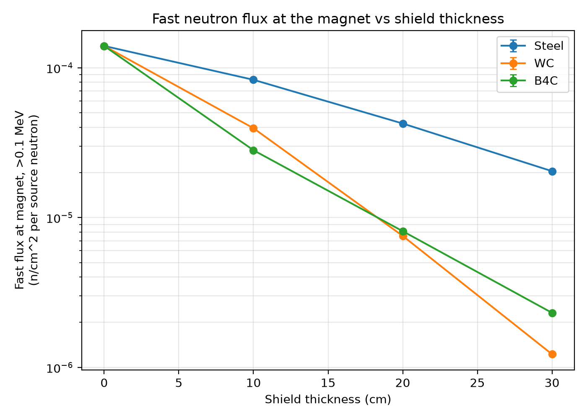
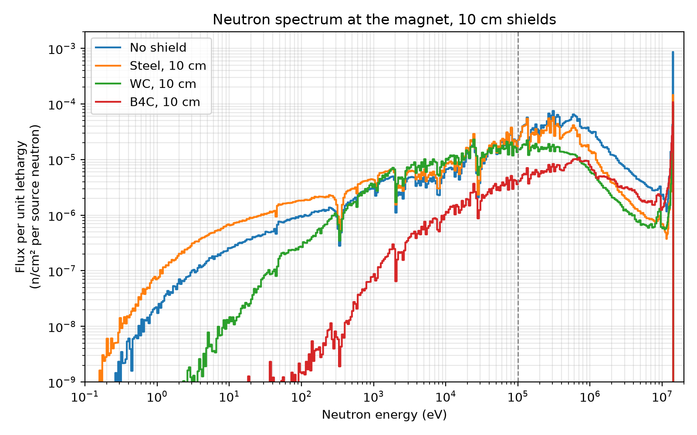

# Fusion Magnet Shielding Study (OpenMC)

This project uses OpenMC to compare three shield materials (stainless steel, tungsten carbide, and boron carbide) for protecting a superconducting magnet from 14.1 MeV fusion neutrons. I learned OpenMC using the [Fusion Energy Neutronics Workshop](https://fusion-energy.github.io/neutronics-workshop/docs/index.html), then built this simple model to get hands-on experience with Monte Carlo neutronics.

## Motivation

In a compact fusion device, the magnets sit close to the plasma, and fast neutrons damage them. The shield between them has to work in very little space. I wanted to see which material reduces the fast-neutron flux at the magnet the most for a given thickness.

## Model

I use a 1D spherical model, from the center outward:

- 14.1 MeV point source at the center
- 50 cm of empty space (the plasma region)
- 5 cm steel vacuum vessel
- Shield: steel, tungsten carbide (WC), or boron carbide (B₄C), at 0, 10, 20, or 30 cm
- 10 cm magnet, modeled as a 60/40 steel/copper mix (an assumed value)

I tallied the neutron flux in the first 1 cm of the magnet: the fast flux (above 0.1 MeV) and the full energy spectrum. Each case ran 1 million neutrons (100,000 × 10 batches) with survival biasing. Statistical errors were under 1% for every result.

Setup: OpenMC 0.15.3, ENDF/B-VIII.0 nuclear data, run in the `fusion-energy/neutronics-workshop` Docker image.

## Two checks

**Distance:** A thicker shield moves the magnet farther from the source in this model, which lowers the flux even with nothing in the way. To account for this, I ran each thickness with an empty gap instead of a shield. The reduction factors below compare each shield with that empty gap.

**Energy threshold:** "Fast" flux is often defined as above 0.1 MeV, but some studies use 1 MeV. I checked both to see whether the ranking changes.

## Results

Reduction in fast flux (>0.1 MeV) compared with an empty gap of the same thickness:

| Shield | 10 cm | 20 cm | 30 cm |
|---|---|---|---|
| Steel | 1.2× | 1.8× | 3.0× |
| WC | 2.6× | 10.3× | 50× |
| B₄C | 3.6× | 9.6× | 26.5× |



- Steel was the weakest at every thickness.
- B₄C was best at 10 cm, the two were close at 20 cm, and WC was clearly best at 30 cm.
- Above 1 MeV, WC was best at every thickness, and B₄C did no better than steel. So which shield looks best depends on the energy threshold used.



## Discussion

The spectra suggest the two materials work differently. WC is very good at stopping the highest-energy neutrons, but tungsten is heavy, so it's bad at slowing neutrons down once they're around 1 MeV. They build up just above the 0.1 MeV cutoff. B₄C is made of light atoms, so it slows neutrons below 0.1 MeV more easily, and boron absorbs the slow ones. But B₄C is not very dense, so more high-energy neutrons get through.

That would explain why B₄C wins for thin shields and WC wins for thick ones. I haven't tested this directly, so it's my best explanation of the spectra rather than a proven result.

## Limitations

- Simple spherical geometry and a point source, not a real tokamak
- No first wall, breeding blanket, or cooling
- Neutrons only: no gamma rays, so no gamma heating
- No activation or material damage calculations
- Results are per source neutron, so they show trends, not design values

## Next steps

- Estimate magnet lifetime by scaling to a fusion power and comparing with a published REBCO fluence limit
- Try a layered shield, like WC followed by B₄C
- Add reaction-rate tallies to test the explanation above
- Add photon transport for gamma heating
- Move to a more realistic tokamak geometry

## How to run

Start the container with this folder mounted:

```
docker run --rm -p 8888:8888 -v "${PWD}:/home/jovyan/openmc-project" ghcr.io/fusion-energy/neutronics-workshop
```

Then open `magnet_shielding.py` and run all cells in order. The cross-section path at the top of the notebook only works inside this Docker image.
